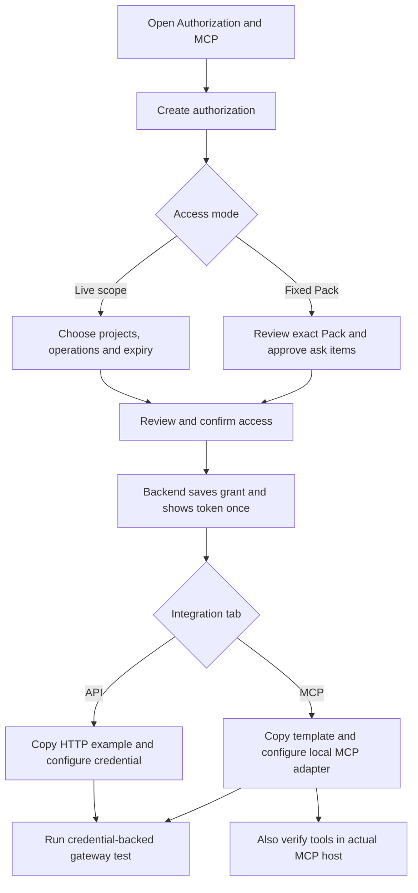
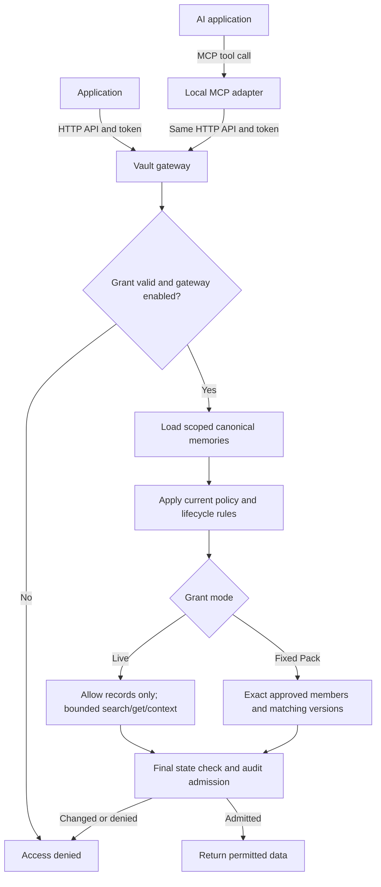
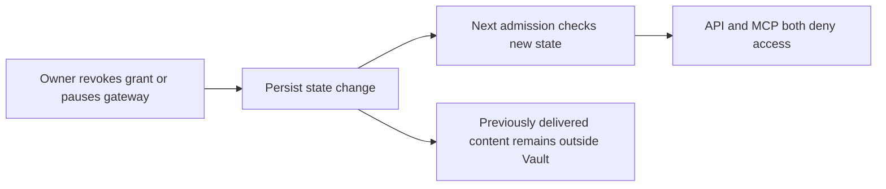

# Memory Pack API, Authorization and MCP Development Proposal

> Updated: 2026-10-25, Asia/Shanghai. Implementation is available in the working tree. Feature acceptance passes; repository-wide baseline failures are recorded in `docs/testing/2026-10-25-vault-api-mcp-validation.md`.
> Product reference: `docs/superpowers/屏幕截图 2026-10-24 172719.png`, supplied by the product manager and inspected directly.
> Execution: implemented inline on `feat/vault-authorization-mcp`, with an independent review and regression fixes. Existing unrelated workspace changes were preserved.

**Goal:** Add an Authorization & MCP page where an owner authorizes an Agent/application, obtains API/MCP setup instructions, verifies access, and revokes it. Consumers can retrieve permitted current memories or receive an explicitly approved Memory Pack without manual file handling.

**Architecture:** One Vault gateway enforces authorization and external-use policy. External applications call its HTTP API directly; MCP clients call a local adapter that uses the same HTTP API. The frontend configures and observes these backend services; it does not host the API or MCP server.

**Tech stack:** Existing Python 3.12+, FastAPI, SQLite, Pydantic and React/TypeScript. Add a tested optional official MCP SDK dependency and a separately launched stdio entrypoint.

**Spec:** Sections 2-10 form the proposed design. Sections 11-13 define implementation tasks and verification. Defaults below are engineering proposals, not prior product-manager decisions.

## 1. Verified baseline and change from the previous proposal

The 2026-10-23 analysis read the project guide, Pack routes/service/contracts, source projection, adapter, store, UI and existing MCP documentation. On 2026-10-24 the prototype, current navigation, memory routes, evidence helpers, settings and health capabilities were also inspected.

- Existing Vault endpoints: `POST /api/v1/packs/preview` and `/packs/export`; formats: Markdown and `vault-memory/1`; actions: copy/download.
- Pack filtering already covers confirmed canonical content, lifecycle, external-use policy, selection, approximate token budget, preview hash and revalidation.
- Current Pack kinds are `fact`, `episode`, `profile`. Older source rows can carry other kinds; the historical six-kind plan must not silently widen this feature.
- `MemoVaultLibraryService.list_memories` currently implements case-insensitive substring filtering, not semantic/vector ranking. Its owner-facing results can contain ask/deny records; it is not an external policy gateway.
- Canonical reads are scoped and paginated, but loading a project can still scan its full relevant collections. A small output token budget does not bound upstream work.
- The current `exports` table records export metadata. There is no working grant/token system, owner session, gateway pause state, or encrypted Vault lock.
- The UI currently has imports/review/library/pack/ADP navigation; Authorization & MCP must be added.
- `docs/mcp.md` describes the separate core EverOS MCP integration. It does not implement Vault egress policy.

Historical verification performed on 2026-10-23:

```bash
.venv/bin/python -m pytest tests/unit/test_entrypoints/test_memo_vault_pack_sources.py tests/unit/test_entrypoints/test_memo_vault_memory_pack.py tests/unit/test_entrypoints/test_api/test_routes/test_memo_vault_exports.py -q
```

Result then: **28 passed in 3.17s**. These tests were not rerun for this documentation-only revision and do not verify the proposed gateway.

**Scope revision:** the earlier proposal prioritized a fixed, single-delivery Pack. The supplied prototype explicitly includes an Agent, project scope, operations, expiry, purpose, reusable client configuration and a search test. Therefore the recommended first release now includes **live, read-only scoped access**, with **approved-Pack delivery as a separate mode**. The old single-use rule applies only to approved-Pack delivery, never to every search call.

## 2. Product structure and options

Two real options were considered:

1. Keep only fixed-Pack delivery and use the prototype as an authorization table. Smaller, but its search/get/build tools and persistent Agent access would be misleading.
2. Implement the prototype as a read-only gateway with two explicit modes. This matches the intended page and reuses Memory Pack for context construction and precise one-time transfers.

**Recommendation: option 2.** Keep write operations and remote OAuth hosting out of the first release.

| Mode | Meaning to the owner | Content changes | Usage and ask policy |
| --- | --- | --- | --- |
| `live_scope` | This Agent may read current allow-policy memories in these selected projects until expiry | Newly confirmed allow memories in the selected scope become visible; each call rechecks current state | Repeated reads subject to rate limits; ask/deny are absent |
| `approved_pack` | This Agent may receive exactly this reviewed Pack once | Selected member/version changes invalidate approval; unrelated changes do not | Single admitted content delivery; ask requires explicit per-item approval |

The creation dialog explains the live mode's inclusion of future allow memories. It is not a frozen snapshot. All stored project scopes are exact project IDs, not name prefixes or implicit descendant wildcards.

## 3. Authorization & MCP page, mapped to the prototype

Add `authorization` to the existing navigation with the requested localized title. Implement a focused page component rather than growing `App.tsx` with all new state. Product copy follows the existing localization approach; new Python/TypeScript identifiers and technical documentation remain English-first.

### 3.1 Header and grant table

Preserve the prototype's header, New authorization action and upper grant table. Columns: subject, namespaces/projects, permitted operations, expiration, purpose, status, actions. Add a compact mode badge so live access and fixed-Pack delivery are distinguishable. Show last use and request ID in expandable details rather than adding many columns.

- Status: active, expires soon, expired, revoked; approved-Pack mode also has consumed/stale. A paused gateway is a global access state, not a mutation of every grant.
- Expiration countdown is computed from UTC state and displayed in the user's timezone; do not copy the prototype's sample dates.
- Revoke requires an explicit user action and immediately updates the row after backend success.
- Recreate with same settings opens a prefilled form, requires review of a new expiry, and issues a fresh grant/token. It never reactivates an expired/revoked token.
- Rotation, if offered, atomically revokes the old credential when issuing the replacement. A plain duplicate of an active authorization requires an explicit warning about simultaneous active grants.
- Purpose is an owner-readable description and audit field, not proof that an external app will obey its declared purpose.

### 3.2 New authorization dialog

Fields: subject label, mode, explicit project selection, memory kinds, operations, purpose, expiry, output budget, evidence permission and rate limits. Default: `live_scope`, 24-hour expiry, three current kinds, search/get/build operations, no evidence access. No default all-project access. Suggested first-release configurable lifetime range: 1 hour to 30 days.

Approved-Pack mode links to the existing Pack selection/preview flow, then returns to this page with an opaque server-side draft ID and summary. The draft and preview must be revalidated before authorization. Do not put memory bodies, raw tokens or full Pack selections in a URL.

The final review states who can access what, which operations, whether future allow records are included, expiry, and that already delivered content cannot be recalled. It separately confirms included ask records for a fixed Pack.

### 3.3 Lower-left integration panel

Keep the prototype's configuration card, but add **MCP configuration** and **API invocation** tabs so both requested entry methods are discoverable on the same page.

- Select a grant, displaying subject plus scope/mode; subject alone is ambiguous if it has multiple grants.
- MCP tab: client-compatible stdio configuration template, executable/prerequisite instructions and Copy template.
- API tab: real base URL, operation list, request body example and Copy example. Use `Authorization: Bearer <TOKEN>` and placeholders for secrets.
- Show a credential only once after creation. Subsequent visits show a safe prefix/suffix and templates with `<YOUR_TOKEN>`, not an apparently executable masked token.
- The server stores only token verifiers; it cannot reconstruct a real token when a dropdown changes. To test after a reload, the owner supplies the credential again or rotates it.
- A secret-inclusive copy action is available only during the creation reveal session and requires explicit selection. Persistent JSON config containing a credential is a local secret file and must be documented as such; prefer environment/credential references when supported by the host.
- Gateway address is generated from actual configuration, not hardcoded to the prototype's `127.0.0.1:8765`.

### 3.4 Lower-right connection test

Retain subject, tool, namespace and Run test controls. Add tool-specific inputs: keyword for search/build, memory ID for get, memory/evidence IDs for evidence, fixed Pack ID for delivery. Never auto-run a content request when selecting a subject/tool.

The test submits an actual external Bearer credential to the same gateway used by applications. Subject is derived from that token; the display selector only filters forms/templates and cannot impersonate an Agent. Neither owner session nor an arbitrary grant ID substitutes for the external token.

Display success/denial, elapsed time, request ID and a bounded result preview. Clear result and in-memory token when switching grants, navigating away, pausing or revoking. Do not put secret/content into localStorage, URLs or analytics.

For approved-Pack mode, label the action as an actual content delivery, warn that it consumes the approval, and require confirmation. A metadata/authorization check is a separate non-consuming test. A browser HTTP test verifies the gateway; it does not prove that an external host has installed the MCP adapter or completed an MCP connection. Provide a separate host-side MCP verification recipe.

### 3.5 Header states and deliberate prototype boundaries

- Implement a persisted backend **Pause external access / Resume** switch. All gateway operations check it, including in-flight reads before final admission. Label it as gateway access, not encryption or Vault decryption.
- Owner-only diagnostics show gateway/upstream reachability. External calls return a generic denial when globally paused or memory storage is unavailable, matching the prototype's fail-closed behavior.
- Hide the prototype's encryption-lock, cloud invocation and demo-control badges until those features exist. Do not claim complete Vault encryption or cloud connectivity based on this feature.
- `propose_memory` is visibly marked planned/disabled rather than included in an effective grant. Future proposals create pending candidates and never directly publish formal memories.
- Preserve the wide-screen table plus two cards; stack cards and allow readable table scrolling on narrow screens. Loading, empty, denial, stale, expired and unavailable states must be explicit.

## 4. One policy model for API and MCP

A grant contains subject label, exact project IDs, allowed kinds, operations, mode, purpose, expiry, evidence ceiling, budget and rate limit; approved-Pack mode also binds a manifest. Each grant has its own credential. Never union grants implicitly because they share a subject name.

Effective visibility is the intersection of request scope, grant scope, confirmed registry membership, active lifecycle, current validity, canonical-body availability, permitted kinds, and external-use policy. Reject an explicitly requested out-of-scope project/operation; do not silently broaden or infer project access through names or parent relationships.

- Live mode: include only `external_use=allow`. Do not expose ask/deny content, titles, snippets, counts or evidence through search, get, context, errors or test previews. No automatic ask approval/request workflow is implied.
- Fixed mode: allow eligible records and individually owner-approved ask records bound to the manifest and one delivery. Deny remains absolute.
- Check grants before project/source reads, and filter egress before shaping counts/snippets and rendering. Never expose raw owner-facing list/detail responses.
- Token identifies the grant and its subject; request `subject`, `user_id` or `app_id` cannot impersonate an identity. Reject unknown fields on external DTOs.
- Source-policy and grant changes during upstream awaits are checked again immediately before response admission.
- Credential labels are not cryptographic identity; a copied Bearer credential carries its access rights.

Threat model: a trusted local owner/OS account delegates through a protected gateway. An arbitrary process running as the same OS user may already read local files or reach the unauthenticated core API. This feature does not sandbox such a process; stronger isolation requires protecting every core/storage access path or separate OS/service identities.

## 5. External operation contracts

All paths below are proposed new contracts. Do not expose current owner library/import routes externally.

| Capability | HTTP endpoint | MCP tool | First-release behavior |
| --- | --- | --- | --- |
| Find current permitted records | `POST /api/v1/external/memories/search` | `search_memory` | Live mode; bounded keyword search with authorized snippets |
| Read one current record | `POST /api/v1/external/memories/get` | `get_memory` | Live mode; exact scoped Vault memory ID, version and content |
| Read limited supporting evidence | `POST /api/v1/external/evidence/get` | `get_evidence` | Explicit opt-in permission; bounded verified excerpt only |
| Construct usable context | `POST /api/v1/external/context/build` | `build_context` | Live mode; authorized current sources rendered as a budgeted Memory Pack |
| Inspect a fixed approved Pack | `GET /api/v1/external/packs/{pack_id}` | `get_pack_info` | Fixed mode; metadata only, no consumption |
| Receive a fixed approved Pack | `POST /api/v1/external/packs/{pack_id}/deliver` | `read_memory_pack` | Fixed mode; one admitted content delivery |
| Suggest a candidate memory | Not exposed initially | `propose_memory` disabled/planned | Follow-up pending-candidate workflow, not direct publication |

External context/search cannot request evidence unless the grant has separate evidence permission. The requested evidence mode may only narrow the grant's ceiling. Initially context defaults to no evidence and permits IDs with opt-in; `get_evidence` separately returns a matched verified excerpt, capped at 360 Unicode characters using existing helpers. Never return whole source conversations, original archives or source-segment fallbacks. Missing/unmatched/hash-invalid evidence yields generic unavailable/denied externally, with owner-only diagnostics. Human-authored memories can have no evidence.

### Search and context semantics

- Suggested request fields: explicit `project_ids`, optional `kinds`, nonempty `query` up to 500 characters, `limit` 1-50 (default 10), opaque `cursor` for search; context adds `token_budget` 100-32000, `format` and permitted evidence mode. Intersect kinds/budget with grant ceilings; reject explicit excess rather than claim it was honored.
- Initial search is case-insensitive keyword substring matching over canonical permitted text, with stable newest-first then ID ordering. Label it keyword search; semantic retrieval can be added later behind the same egress gate.
- Search pagination counts/offsets consider only permitted visible results. Use a versioned, server-authenticated cursor bound to grant, exact query/scope and permitted-result revision digest. Revoke/policy updates or digest changes invalidate it with a generic restart-required response; it never discloses hidden counts.
- Initial implementation can reuse bounded canonical scans. Proposed hard limits: 5,000 canonical rows scanned per call across projects, 1 MiB response, 30-second upstream deadline, 30 requests/minute and 2 in-flight calls per grant. Reject incomplete/oversized work before admission, never silently claim complete results. Wire scan limits into adapter pagination rather than checking only after all pages load. Bound any cursor state and expire it after 5 minutes.
- `build_context` applies the same live visibility gate first, then reuses Pack whole-item budgeting/rendering. It may return fewer records for budget reasons, with only authorized exclusion information and `estimate_is_approximate=true`.
- Live calls can return updated allow content on the next call; fixed mode must never silently substitute a changed version.

JSON memory/context results retain `vault-memory/1` where applicable. A versioned transport envelope carries request ID, receipt ID and estimates outside the Pack schema. Define content hashes over the exact pinned rendered artifact bytes, not the surrounding HTTP/MCP envelope. The fixed delivery endpoint returns those exact JSON/Markdown bytes with `X-Content-SHA256` and receipt headers; no hash equivalence is claimed for a client's reserialized JSON.

Use `Cache-Control: no-store`. Invalid/revoked/expired credentials, inaccessible records, disallowed operations, globally paused gateway and unavailable memory backend produce stable `access denied` responses without internal addresses or content. Use 401 for unauthenticated, 403 for denied/unavailable, 429 for rate/concurrency limits; owner diagnostics and sanitized audit reasons preserve the actionable distinction. `PACK_APPROVAL_STALE` is visible only to a currently authorized fixed-Pack client; malformed inputs are 422 and changed search cursors return 409. MCP maps the same semantic errors to its tool error envelope.

## 6. Owner API and control-plane protection

Owner-only routes, protected by a locally provisioned owner session/credential:

- `POST /api/v1/grants`: create a reviewed live or fixed grant and reveal token once.
- `GET /api/v1/grants`: metadata, status and token fingerprint only.
- `DELETE /api/v1/grants/{grant_id}`: idempotent revoke.
- `POST /api/v1/grants/{grant_id}/rotate`: replace credential atomically; old credential immediately loses admission rights.
- `GET /api/v1/gateway/status` and `POST /api/v1/gateway/pause` / `resume`: owner status/control.
- `GET /api/v1/grants/{grant_id}/audit`: bounded sanitized request metadata, no memory bodies or secrets.

These replace the previous draft's `/pack-authorizations` route names; no implementation or compatibility promise exists for those draft names.

Keep owner and external route surfaces on separate ASGI applications/listeners with an explicit route allowlist. New external listener default proposal: `127.0.0.1:8766`, configurable; existing owner UI API remains 8765, core remains 8000. The page shows the configured gateway address. An MCP adapter can live on the same machine while the owner API stays private.

Implement owner bootstrap/session, origin/host checks, and CSRF protection for cookie-authenticated mutations. External tokens never authenticate as owner or grant access to existing preview/library/import endpoints. No frontend-only permission gate. Local and remote reverse-proxy configurations must not expose core/control routes accidentally. CORS, if needed for the local connection-test UI, uses exact trusted UI origins and does not substitute for Bearer authentication. The browser sends the supplied token directly to the configured local gateway; an owner-side proxy must not allow arbitrary target URLs.

## 7. Token, state, admission and audit

### Credentials and lifecycle

Generate high-entropy opaque tokens, e.g. `mv_<random>`, and store only secure verifiers plus a display fingerprint. The credential shown once is the only recoverable copy; dropdowns and list APIs cannot reveal it. Create/rotate responses use no-store and log redaction. No query-string secrets, default secret persistence, or tokens embedded in git-tracked examples.

Live grant lifecycle: active -> expired/revoked. Fixed grant additionally transitions active -> consumed, or becomes stale if its approved members no longer match. Recreate creates a new record and consent; it never changes history.

Persist gateway pause across process restart. An initially unconfigured external gateway starts paused; owner setup explicitly enables it. Pausing/revoking does not erase receipts or recover already delivered content.

### Fixed-Pack approval integrity

Store selected IDs/revisions/hashes, fixed timestamp, format/evidence mode, kind/project scope, budget, serializer version, manifest hash and artifact hash. Store no additional memory bodies. Reconstruct from current canonical content; any selected content/lifecycle/policy/evidence rendering change invalidates approval. Unselected-record changes do not.

The existing preview hash covers a broader source set; use it to validate owner preview -> approval, and define a separate manifest identity for persistent authorization. Freeze generation time and renderer version; unsupported historical versions require reapproval.

### Final admission transaction

Load and render upstream content outside a SQLite write transaction. In a final short transaction, recheck credential/grant version, expiry, operation/scope, gateway state, local source revisions/policy/expiry, and rate/use reservation; write the sanitized audit/receipt before admitting response bytes. Upstream failure or rejected admission never produces a successful receipt.

Fixed grants atomically reserve one content use; concurrent requests admit at most one response. Metadata checks do not consume it. Live grants admit repeated permitted calls and each receives an audit entry. Calls admitted before revocation/pause may finish; calls admitted after the state commit must fail. This is the promised boundary, not a guarantee to recall in-flight bytes. Cross-service core reads are not a distributed linearizable snapshot.

A fixed approval is consumed on admission even if the response is subsequently lost. Show that distinction in UI; no silent replay or exactly-once client receipt promise. If audits cannot be persisted, fail closed before delivery. Creation can use an owner-scoped idempotency key to prevent duplicate grants after form retries without replaying an already revealed secret indefinitely.

Audit fields: request/receipt ID, grant ID, subject reference, operation, transport, admitted/denied reason, scoped record IDs/revisions/hash, timestamp, duration and bounded counts. No query text by default, memory/evidence bodies, token or raw HTTP request. Audit purpose/subject labels are untrusted display strings. Use a bounded retention/pagination policy; proposed default retention 30 days, owner configurable.

## 8. MCP adapter and installation

MCP presents callable tools to an AI application. Its stdio process invokes the exact same external HTTP API with the configured credential; it never calls the core memory API or reads Vault files/database directly.

- Start with stdio, not a browser-hosted MCP server. Include get/read fixed-Pack tools only for fixed mode and live tools only for live mode. Server-side authorization is authoritative even if a client sends an unadvertised tool.
- `tools/list` uses grant capabilities without returning memory content; dynamic revocation is enforced on every call regardless of a client's cached tool list.
- Token and gateway are process configuration, never model-supplied tool arguments. Do not add a create-grant or confirm-ask tool.
- Preserve typed JSON outputs with the tested SDK, text fallback for explicitly tested hosts, and consistent tool errors. Mark outputs as user data; tool annotations do not imply retry safety for single-use delivery.
- Protocol stdout remains clean; diagnostics go to stderr with secrets/body redacted.
- On host-side validation, check process launch, tool discovery and an actual authorized call. The page's HTTP test is reported separately.

Proposed installable command, subject to an implementation packaging check: `everos vault-mcp --gateway http://127.0.0.1:8766`, with `MEMO_VAULT_TOKEN` read from environment. Extend the existing Typer command tree without changing core MCP behavior. Config templates are generated only for an executable that is actually shipped and tested; the prototype's `memo-vault mcp` is not assumed to exist.

A generic JSON template, shown as a template until a real local credential is supplied:

```json
{
  "mcpServers": {
    "memo-vault": {
      "command": "everos",
      "args": ["vault-mcp", "--gateway", "http://127.0.0.1:8766"],
      "env": { "MEMO_VAULT_TOKEN": "<YOUR_TOKEN>" }
    }
  }
}
```

MCP host formats vary; initially verify at least one supported JSON-configured host and document its tested version. Do not claim this template imports unchanged into every host. An optional MCP package must not break ordinary EverOS installations without the SDK.

Remote MCP is deferred: Streamable HTTP, TLS and the MCP HTTP authorization profile, including OAuth discovery and resource/audience binding, require separate compatibility work. Official MCP guidance distinguishes stdio environment credentials from HTTP authorization. References checked on 2026-10-24:

- [MCP transports](https://modelcontextprotocol.io/specification/latest/basic/transports)
- [MCP authorization](https://modelcontextprotocol.io/specification/latest/basic/authorization)
- [Existing EverOS-MCP repository](https://github.com/EverMind-AI/EverOS-MCP), consulted in the initial analysis

## 9. Component and persistence plan

Use shared application services with dependency-injected source, renderer, repository and clock ports; no service-layer imports of `everos.entrypoints.*`. Adapt the existing Vault loader/renderer/store from the composition root rather than relocating the entire Vault subsystem.

| File/unit | Responsibility |
| --- | --- |
| `src/everos/service/memo_vault_grants.py` (new) | Grant creation/revoke/rotation/pause state use cases |
| `src/everos/service/memo_vault_gateway.py` (new) | Shared visibility, permitted reads/context, admission and audit |
| `src/everos/service/memo_vault_export_contracts.py` (new) | Neutral typed contracts and source/repository/renderer ports |
| `src/everos/entrypoints/memo_vault/gateway_contracts.py` (new) | Owner and external HTTP DTOs and limits |
| `.../memo_vault/auth.py`, `routes/grants.py`, `routes/gateway_control.py` (new) | Owner session and thin management adapters |
| `.../memo_vault/external_app.py`, `routes/external_gateway.py` (new) | Allowlisted external app and thin operation adapters |
| Existing `library.py`, `adapter.py`, `memory_pack.py` | Bounded sources, final-state checks and public renderer adapter |
| Existing `storage.py`, `config.py`, `app.py`, `routes/system.py` | Migrations, ports/state settings, composition and honest capability state |
| `src/everos/entrypoints/memo_vault_mcp/` (new) | stdio HTTP adapter and tool schemas |
| Existing CLI command registration, `pyproject.toml`, lockfile | MCP command and optional dependency packaging |
| `apps/memo-vault-ui/src/AuthorizationMcpPage.tsx` (new) | Page composition and isolated form/state |
| New focused frontend grant/config/test components | Grant dialog/table, templates and credential-backed connection tests |
| Existing `src/api.ts`, `App.tsx`, `styles.css` | Typed clients, navigation and layout integration |

Persistence with idempotent migrations: `export_grants` plus exact grant-scope data, `approved_packs` (manifest only), `gateway_state`, and `gateway_audit` (bounded metadata). A grant can reference a fixed manifest. Integrate fixed delivery receipts with existing `exports` or a dedicated receipt table without relabeling historical copy/download events as confirmed external receipt. Do not require new full-text memory storage or store plaintext tokens.

## 10. Explanatory flows

### Owner setup, shared by API and MCP



### Runtime, same checks through both entry methods



### Revoke and pause



## 11. Development tasks and acceptance

### Task 1: Policy contracts, bounded read adapters and fixed manifests

- [x] Define grant modes, allowed operations, typed ports/results/errors and proposed default limits from sections 2-5.
- [x] Write failing tests for live allow-only search/get/context, absence of hidden counts/snippets, current three kinds, exact project scopes, kind narrowing, evidence opt-in and unsupported operations.
- [x] Implement policy projection using confirmed canonical sources; do not reuse owner-facing responses directly. Add adapter scan/deadline caps and authenticated scoped cursor handling.
- [x] Test fixed-byte rendering with frozen timestamp/version, selected-member mutation, unrelated changes, stale evidence and oversized results.
- [x] Run new service/source tests plus the existing three Pack test modules; preserve owner copy/download contracts.

**Tests:** `tests/unit/test_service/test_memo_vault_gateway.py`, `test_memo_vault_export_delivery.py`; extend existing source/adapter/renderer tests.

### Task 2: Owner authentication, grants, pause and audit persistence

- [x] Test owner bootstrap/session and reject external credentials on owner/library/import routes; cover CSRF, host/origin validation and no global all-project default.
- [x] Test old-DB migration/reinitialization, secret verifier storage, secret reveal once, valid expiry range, separate grants per subject, recreate/rotate behavior and pause persistence.
- [x] Implement protected owner routes and repository adapters, including metadata-only sanitized audit with bounded retention.
- [x] Test idempotent revoke, atomic rotation, old-token rejection, service restart while paused, and failure to persist audit/state.

**Tests:** new `tests/unit/test_entrypoints/test_memo_vault_grants.py`, `test_memo_vault_gateway_auth.py` and store migration tests.

### Task 3: External HTTP gateway and concurrency

- [x] Write contract tests for each enabled operation, response schema/hash, exact egress filtering, generic access denied behavior and no cross-grant identity spoofing.
- [x] Implement the separate external app and endpoint allowlist; owner session never substitutes for an external token.
- [x] Test final-admission policy/grant expiry changes, revoke/pause during upstream awaits, changed cursors, storage outage and no fallback to candidate/archive text.
- [x] Test one-use fixed delivery under concurrency, live repeated reads, per-grant rate/concurrency caps, 1 MiB responses, scan cap and 30-second deadline.
- [x] Inject response loss and audit failure; verify honest consumed/admitted status and no false client-receipt claim.

**Tests:** new `tests/unit/test_entrypoints/test_memo_vault_external_gateway.py`, concurrent service tests. Add a synthetic HTTP API client example.

### Task 4: Authorization & MCP page

- [x] Add navigation and focused page/components matching the prototype's grant table and two lower cards, with API/MCP tabs.
- [x] Implement grant form, live/fixed mode explanation, exact scope review, expiry/status/last-use display, revoke, recreate and rotation feedback.
- [x] Connect the fixed-Pack selection round trip with server-side draft/revalidation; preserve existing copy/download.
- [x] Implement one-time token reveal, accurate placeholders and configuration templates, no hidden secret recovery, and clear test inputs/results.
- [x] Exercise create -> API test -> audit -> revoke -> access denied; verify grant changes clear credentials/results and actual fixed delivery is never triggered automatically.
- [x] Test narrow screens, missing prerequisites, gateway outage/pause, expiry, stale Pack, empty/loading/error states and keyboard-accessible controls.
- [x] Run UI build and focused UI tests; if no UI test runner exists, choose a minimal established runner during implementation and record manual acceptance separately.

### Task 5: stdio MCP adapter and client verification

- [x] Test tool discovery for live/fixed modes, permission enforcement on direct unadvertised calls, output/error mapping and credential isolation from tool arguments.
- [x] Implement an adapter over the shared HTTP API; check no direct core/SQLite/filesystem access.
- [x] Add and package the actual CLI command plus optional SDK dependency, then generate matching templates. Missing optional dependency produces a useful installation message.
- [x] Verify clean protocol stdout, redacted stderr and a real supported host's launch -> tools/list -> allowed call -> revoke -> denied call cycle.
- [x] Report HTTP test and actual MCP-host test independently; document tested host/protocol versions and local-only reachability.

**Tests:** new `tests/unit/test_entrypoints/test_memo_vault_mcp.py`, CLI smoke/packaging tests.

### Task 6: Cross-surface integration and documentation

- [x] Run API and MCP with the same synthetic grant/query; confirm equivalent authorized results, scope and receipts.
- [x] Verify pause/revoke/storage-unavailable rejection on every operation, including evidence, context, metadata and fixed delivery.
- [x] Verify external OpenAPI and deployment routing contain no owner/core/import routes. Test allowed browser origin and rejection of untrusted origins/hosts.
- [x] Advertise live gateway, fixed delivery and stdio MCP capabilities independently. Leave candidate write, encryption lock, remote OAuth/MCP and ADP unready.
- [x] Run focused new/existing tests, UI build, lint/import checks, datetime checks and locale-aware language checks; record pre-existing failures separately.
- [x] Update available project/MCP documentation and the English gateway guide without claiming the pre-existing core MCP enforces Vault policy.

## 12. Review focus and release criteria

1. No ask/deny/unapproved record leaks through search snippets, result counts, detail, context, evidence, test preview or error shape (Tasks 1 and 3).
2. No subject selector, request identity, owner session, shared subject name or stale tool listing expands a token's authority (Tasks 2-5).
3. Revoke/pause/expiry committed before final admission prevents data delivery; concurrent single-use delivery admits at most one response (Tasks 2-3).
4. Live mode observes current allow state; fixed mode rejects selected-member/version changes while ignoring unrelated changes (Tasks 1 and 3).
5. Configuration templates use an actual executable and explain missing credentials; HTTP test success is never presented as proof of an MCP-host connection (Tasks 4-5).

Release acceptance: from Authorization & MCP, an owner creates a bounded live grant, tests HTTP access, connects a tested MCP host, obtains only permitted current memories/context, and revokes both paths at once. A separate fixed mode delivers the exact reviewed Pack with one-use semantics. Audit contains no secrets or memory bodies. No prototype-only encryption, cloud, or write capability is represented as working.

## 13. Effort and deferred scope

Revised planning estimate for one developer familiar with the project: **12-18 working days**, including a review cycle. Approximate allocation: shared policy/bounded reads/fixed manifests 3-4; owner auth/grants/audit 2-3; external API/concurrency 2-3; prototype-based UI 2-3; MCP packaging/real host/integration/documentation 3-5, with overlap. These are planning ranges, not measured commitments. Real environment/client failures can change the range.

Follow-ups: `propose_memory` pending-candidate workflow; owner approval requests for live ask content; semantic retrieval; reusable fixed allow-only deliveries; remote HTTP MCP/OAuth; stronger local process isolation; encrypted Vault lock; push connectors; full-history export and incremental synchronization. Each requires its own scope; none is silently included by a UI placeholder.

## 14. Implementation record (2026-10-25)

The Authorization & MCP page, protected owner session/CSRF boundary, live gateway,
fixed Pack approval/delivery, evidence permission, pause/revoke/rotation, creation
retry deduplication, metadata audit, scoped stdio MCP discovery and CLI are
implemented. Management routes are consolidated in `routes/grants.py`; creation
policy lives in `service/memo_vault_grants.py`.

Feature verification: 56 focused backend/source/Pack tests passed. Real Chromium
and an independent SDK stdio subprocess validate live access, fixed Pack
authorization/delivery, revocation, and mobile layout. MCP SDK 1.30.0 is the tested
protocol client; vendor desktop-host compatibility is not claimed.

Checkboxes above track implementation and execution of checks, not a claim that
the entire repository is green. Seven unrelated existing tests and one LLM setup
error remain after full-suite failure recheck; see the validation report for
names, environment filtering, architecture/date baseline issues and commands.

Usage: [Vault authorization guide](../../memo-vault-authorization.md).
