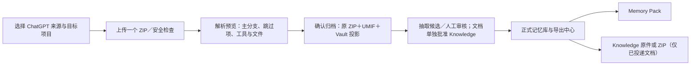

# ChatGPT 数据导入与 EverOS 全链路设计（待审核）

> 日期：2026-10-28  
> 状态：设计提案，未经用户批准；本阶段不修改产品代码。

## 1. 目标与已检查的样本

让用户在现有统一五步向导中上传 ChatGPT 账户导出 ZIP，检查和预览后归档为一份 UMIF 包；可见用户对话经现有候选抽取与人工审核进入 EverOS 正式记忆，并沿用现有记忆库、Memory Pack 导出。可识别的工具事件和文件分别进入 Agent 轨迹与待审批的 Knowledge 轨道，不能混入用户对话记忆。

本次样本：`docs/memo_input/ChatGPT/c0b40102f78911d98d4d67cdb9e6e6be40a9e4ccb390c178eb0388c971f74fe3-2026-10-26-14-50-23-a6ab51ccb8a14df1920bb186c6f84f45.zip`，大小约 58.5 KB，含 9 个成员：`conversations.json`、`chat.html`、`user.json`、`user_settings.json`、`export_manifest.json`、`sites/export_manifest.json`、`ads.json`、`library_files.json`、`sectioned_conversations.json`。`conversations.json` 有 3 个会话、17 个节点，其中 14 个节点含消息；内容类型有 `text`、`reasoning_recap`、`thoughts`。样本无附件文件，也没有可确认的工具调用。`library_files.json` 和 `sectioned_conversations.json` 为空。ChatGPT 导出格式可能随版本变化，此样本不能证明所有变体都已覆盖。

## 2. 产品边界与方案比较

| 方案 | 做法 | 取舍 |
|---|---|---|
| A：ChatGPT 专用解析器，接现有 UMIF 与 Vault（推荐） | 只新增来源适配；复用统一五步、候选审核、Knowledge 投递和导出 | 保留来源语义；改动范围可控；需明确处理树形会话和文件引用 |
| B：把 ZIP 交给通用 JSON/ZIP 解析器 | 不建新适配器 | 通用解析器不理解 `mapping/current_node`，可能把系统、推理和支线误当用户聊天 |
| C：单独建设 ChatGPT 导入向导及导出链 | 自成一套页面/API | 重复 Claude 已有能力，增加 UI 与状态分叉 |

推荐 A。它遵守既有 UMIF 规范和统一内容轨道设计，同时不改变 Claude 多 ZIP 或 DeepSeek Harness 的语义。本提案默认单次上传一个 ChatGPT ZIP，目标项目由用户选择；不接入 ChatGPT 账号授权或云端下载。

## 3. 数据映射与审核规则

| ChatGPT 导出内容 | UMIF 及 Vault | 后续动作 |
|---|---|---|
| `conversations.json` 的会话和可见 `text` 消息 | `Session`、`event.message`，保存源会话/节点 ID、父节点、时间、角色、模型/分支元数据及 JSON 指针；归档后投影到 `normalized_messages` | 仅主分支的用户/助手可见正文参与候选抽取；候选仍须人工审核，发布后才进入 EverOS 正式记忆与 Memory Pack |
| 非当前分支的可见消息 | 同样保留在 UMIF 与 Vault，标记分支状态、`user_memory=deny` | 默认不参与候选抽取；不能静默拼接成主分支 |
| `thoughts`、`reasoning_recap`、system/developer 指令及无法确认可见性的内容 | 原 ZIP 保留；UMIF 仅记录安全的跳过计数/来源引用，不复制隐藏推理正文到可展示或抽取事件 | 不进入候选、Agent 轨迹或 Knowledge；预览只显示数量与原因 |
| 明确的工具调用及工具结果（若后续导出包含） | 可确认角色、工具名、调用 ID 和配对关系时转换为 `event.tool_call` / `event.tool_result`，投影到既有 `normalized_tool_events` | 独立 Agent 轨迹，预览脱敏截断；不参与用户记忆抽取，不自动生成 Case/Skill |
| ZIP 中实际存在且能安全解析的附件或用户上传文件（若后续导出包含） | `asset`/`document` 和 blob；用稳定来源指针关联消息或文件清单。引用缺失或歧义时只记警告 | 默认留 Vault；用户点击“批准进入 Knowledge”后投递原文件。缺失引用不得凭文件名猜测配对 |
| `user.json`、设置、广告、`chat.html`、导出清单及未知成员 | 完整保留在原 ZIP；必要的来源身份和清单哈希入 UMIF manifest/import report | 不作为独立用户记忆或 Knowledge 文档；不展示邮件、生日等账号字段 |

会话顺序从 `current_node` 沿 `parent` 回溯并反转，不能直接按 `mapping` 对象顺序读取。节点缺失、环、重复 ID、断链、时间缺失和未知内容类型均应生成明确报告；无法安全确定主分支时保留原件，阻止该会话进入抽取，不用猜测顺序。`is_do_not_remember=true` 的会话照样归档，但所有消息标记 `user_memory=deny`。`is_archived` 只表示 ChatGPT 侧归档状态，不自动禁止抽取。

对导出中的 URL、`content_references`、搜索结果等引用，只保留来源关系；没有本地原文件字节时不生成可投递的 Knowledge 文件。ChatGPT 平台“已保存记忆”只有在未来导出出现明确独立字段且能识别来源时才映射 `memory.assertion`；本样本的 `user_settings.json` 不按此处理。

## 4. 一条统一的用户流程

向导继续使用已有“选择来源 → 上传与检查 → 解析预览 → 抽取与审核 → 完成”步骤和白色卡片、蓝色按钮、同款消息/工具表格。ChatGPT 不新增第二条步骤条或深色专属页头。预览展示会话、主分支可抽取消息、保留但不抽取的分支/内容、工具调用/结果、文件数及警告；长正文按现有预览上限截断。归档后支持继续抽取或稍后从批次恢复；未确认归档前不写正式记忆或 Knowledge。

Knowledge 审批沿用 Claude 文档卡片的单一“批准进入 Knowledge”动作；不操作则继续留在 Vault。没有可投递附件时，页面显示“本次导出没有可投递文件”，不制造空卡片。导出中心复用现有 Memory Pack 与 Knowledge 两个入口，不新增 ChatGPT 专属导出格式。

## 5. 技术接入边界

1. 新建 `src/everos/entrypoints/memo_vault/chatgpt_export.py`：校验 ZIP 与 JSON 结构、遍历会话树、产生 UMIF 与导入报告。使用既有 `record_id`、内容哈希、`seal_package`、blob/manifest 规则。来源身份以导出 `user.id` 的稳定散列或 Vault 本地 Owner 命名空间表达，不在 UI、日志、UMIF 公共字段明文传播邮箱/生日。
2. 扩展 `ImportService` 的 `source_type="chatgpt"` 分支：单 ZIP 预览、项目校验、UMIF 校验、重复检测、原件与包持久归档、投影到 `normalized_messages`/`normalized_tool_events`。复用 Claude 已有的 UMIF 证据、候选与文档审批链路，但来源条件显式包含 ChatGPT；不修改 DeepSeek 的 Harness 读取规则。
3. 扩展 `content-inventory` 及文档审核路由的来源判断，使 ChatGPT 的轨道记录和可投递文件可按批次查询；权限、项目隔离、幂等和投递状态核对沿用现有协议。
4. 前端在来源卡启用 ChatGPT；在同一五步向导渲染单 ZIP 上传与解析预览，沿用 DeepSeek 的指标/消息/轨迹表格与 Claude 的文档审核卡片。候选审核、记忆库、Memory Pack 和 Knowledge 导出复用现有页面。
5. 导入包安全边界：拒绝路径穿越、符号链接、重复路径、加密或不支持压缩方式、嵌套归档、超限解压体积/文件数/压缩比；完整验证后才生成预览或归档。未知文件保留于原 ZIP 且记录到报告，不作为正文或附件自动投递。

当前 `ImportService.preview()` 的普通单文件默认上限为 100 MiB，解压后默认 50 MiB。实施时应确定 ChatGPT 导出是否复用这些上限，或给 ChatGPT 单独设置与 Claude 相当的可配置限额；不得为了大文件直接取消安全限制。为避免一次把大 `conversations.json` 全部载入内存，解析器应按成员限额读取并对大型导出采用流式 JSON 解析或明确的可配置上限，预览与最终归档使用同一解析结果/哈希。

## 6. 分阶段开发与验收

1. **解析与 UMIF：** 用本样本固定结构建立解析契约；覆盖树形主分支、角色/内容类型、时间、来源指针、重复节点、异常分支与 ZIP 安全。产出的包通过 UMIF 校验，原 ZIP 与 UMIF 哈希可追溯。
2. **Vault 接入：** 预览、确认归档、重启后恢复、重复导入行为和轨道投影接上现有接口；验证主分支可见消息才成为抽取输入，工具事件绝不进入用户消息。
3. **统一 UI 与审核：** 完成五步、统计/警告、工具表格、缺失附件提示、候选审核及 Knowledge 单按钮审批；不出现 Claude/DeepSeek 风格分叉。
4. **导出与回归：** 人工确认候选后在记忆库可见且 Memory Pack 可导出；若有真实附件，批准后可通过 Knowledge 单篇/ZIP 导出。Claude 四 ZIP 与 DeepSeek Harness 导入、轨迹和导出路径保持现状。

端到端验收使用用户提供的 ZIP：上传 → 预览 3 个会话及来源报告 → 确认归档 → 抽取候选 → 人工审核发布至少一条可证据化记忆 → 记忆库读取 → Memory Pack 预览/下载。此 ZIP 没有附件，因此不能作为 Knowledge 投递或工具轨迹实际成功的证据；这两条路径需要独立的、经过脱敏的结构化样本验收，不得伪造本样本含有的数据。

## 7. 待用户确认的产品决定

**主分支策略（推荐）：** 默认只让 `current_node` 对应路径的可见用户/助手正文进入候选抽取；其他分支保留在 Vault 与 UMIF，但不抽取。这能避免相互矛盾的编辑分支被混为一段对话。若用户希望“所有分支都参与抽取”，需另行定义分支隔离和去重语义。

其他设计为本提案的实现建议，尚未得到用户批准。审批本设计后再编写逐任务实施计划和修改代码。
